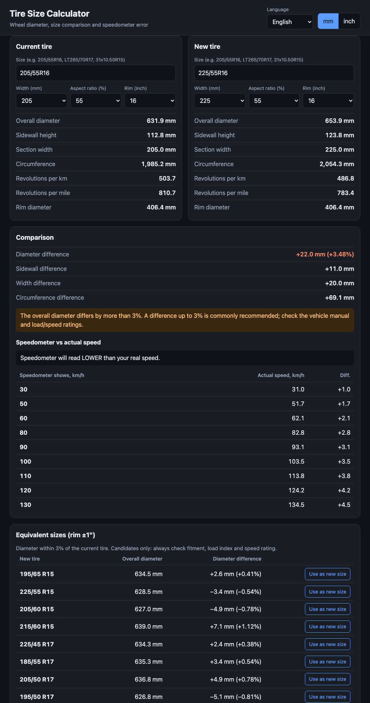

# Tire Size Calculator

Free, dependency-free **tire / wheel size calculator**: overall diameter from a size like `205/55 R16`, side-by-side comparison of two sizes, speedometer error table and "plus sizing" equivalents.

*UA:* Калькулятор розмірів шин: діаметр колеса, порівняння двох розмірів, похибка спідометра. · *RU:* Калькулятор размеров шин: диаметр колеса, сравнение двух размеров, погрешность спидометра. · *BG:* Калкулатор за размер на гуми: диаметър на колелото, сравнение на два размера, грешка на скоростомера.



## Features

- Parses `205/55R16`, `205/55 R16`, `205/55-16`, `LT265/70R17`, `P215/65R15`, `225/45ZR17` and flotation sizes like `31x10.50R15`; or pick width / aspect ratio / rim from dropdowns.
- Per size: overall diameter, sidewall height, section width, circumference, revolutions per km and per mile, rim diameter.
- Compare old vs new: difference in mm and %, speedometer vs actual speed table (km/h or mph), warning above 3% (a commonly recommended limit, not a legal rule).
- Plus-size suggestions: rim ±1" with width / profile keeping diameter within 3%.
- mm / inch toggle, UI in English, Ukrainian, Russian, Bulgarian (`?lang=uk`, `ru`, `bg`, `en`).
- Shareable links: `?old=205/55R16&new=225/45R17`.
- Light / dark theme, responsive, keyboard accessible. Vanilla JS, no build step, no external requests, no trackers.

## Formulas

```
sidewall_mm      = width_mm * aspect_% / 100
overall_diameter = rim_in * 25.4 + 2 * sidewall_mm
circumference    = pi * overall_diameter
revs_per_km      = 1,000,000 / circumference_mm
revs_per_mile    = 1,609,344 / circumference_mm
```

Example: 205/55 R16 -> 16 * 25.4 + 2 * 205 * 0.55 = 631.9 mm. Flotation `31x10.50R15` has a nominal overall diameter of 31 in = 787.4 mm.

Speedometer: it is calibrated for the old size, so `actual = shown * new_diameter / old_diameter`. A larger new tire makes the speedometer read lower than the real speed.

Results use nominal dimensions. Real tires vary by brand, load, pressure and wear; always check the vehicle manual, load index and speed rating.

## Use the module

`tire.js` is a pure ES module (browser and Node 16+), no dependencies.

```js
import { parseTireSize, tireDimensions, compareTires, suggestPlusSizes } from './tire.js';

parseTireSize('205/55 R16');   // { type: 'metric', prefix: '', width: 205, aspect: 55, rim: 16 }
tireDimensions('205/55R16').diameterMm;   // 631.9

const c = compareTires('205/55R16', '225/55R16', { unit: 'kmh' });
c.diameterDiffPct;       // 3.48
c.exceedsTolerance;      // true (default tolerance 3%)
c.speedometer;           // [{ indicated: 100, actual: 103.5, diff: 3.5 }, ...]

suggestPlusSizes('205/55R16');   // [{ size: '225/45 R17', diffPct: 0.38, ... }, ...]
```

## Run locally / tests

```
npm test            # node --test tests/tire.test.mjs
python3 -m http.server   # then open http://localhost:8000
```

The page uses ES modules, so open it through a web server (or GitHub Pages), not `file://`.

## GitHub Pages

Repository Settings -> Pages -> Source: *Deploy from a branch* -> `main` / `/ (root)`. The site appears at `https://<user>.github.io/tire-size-calculator/`. All paths are relative.

## Contributing

Issues and pull requests are welcome: new languages (add an object in `i18n.js`; the test checks all keys exist), more size formats, bug reports with a size that fails to parse. Run `npm test` before submitting.

## Who made this

Made by [Evimarko](https://evimarko.com/?utm_source=github&utm_medium=referral&utm_campaign=tire-calculator) - CRM for tire shops, auto repair and detailing studios (PROGRESS MARKETING LTD EOOD).

## License

MIT, see [LICENSE](LICENSE).

<!--
Suggested GitHub topics: tire-calculator, tyre-calculator, wheel-size, tire-size, speedometer, automotive, car, plus-sizing, vanilla-js, no-dependencies, github-pages, i18n
Suggested description: Tire size calculator: wheel diameter, compare two sizes, speedometer error, plus-size equivalents. Zero dependencies.
-->
